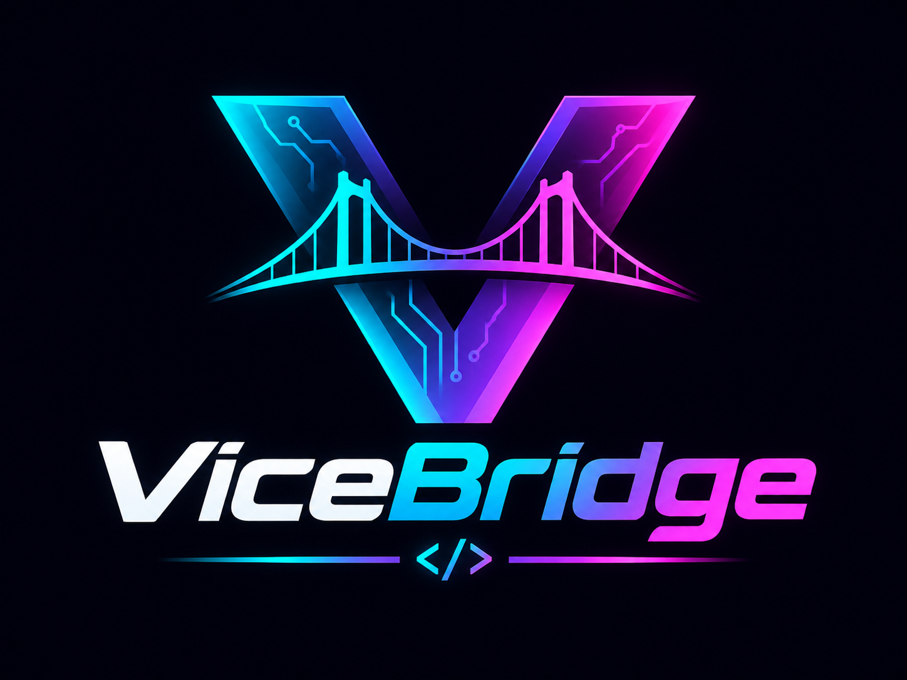

# ViceBridge

<p align="center">
  
</p>

An independent experimental Xbox Series-to-PC compatibility project, maintained by **FarhatFIN**.
Based on the preserved Leonida source history and our local compatibility work.

**The game does not reach a verified main menu. This is source code for research and development, not a playable release.**

## What is included

- The inherited PE loader, console API compatibility layer and RDNA2-to-SPIR-V tools.
- Host-backed APU memory management and safer XApu connection handles.
- DirectStorage file/memory reads, CPU zlib decompression and physical-page destinations.
- An explicitly enabled experimental host-linear XG texture layout/copy model.
- A fallback decoder for incomplete FidelityFX shader disassembly.
- Synthetic tests and documentation separating measured ABI facts from hypotheses.

No game executables, archives, extracted resources, generated shaders, keys or protection workarounds are included.
Game-specific input files and generated output remain outside this repository.

## Current limits

Audio DSP commands and hardware initialization are not implemented; initialization failure is a known boot blocker.
BCPack, Xbox swizzle and physical-page sources remain unsupported in DirectStorage.
The XG host-linear model is disabled by default. `LEONIDA_XG_LINEAR=1` opts into a limited experimental model;
it does not provide native Xbox tiled layouts or Vulkan texture uploads.
Wave64 vertex/pixel/geometry behavior on 32-wide NVIDIA/Intel subgroups can be approximate.

Local preparation previously translated and SPIR-V-validated all 26,503 main shaders and 29/29 FidelityFX programs.
The 29 FidelityFX compute pipelines were also accepted by a GTX 1650 driver. These are preparation/driver results,
not proof of correct rendering or game startup. The full main-corpus GPU check was not completed.

## Build and test

The inherited runtime uses a C++20 compiler, CMake and Ninja. Windows builds need an MSVC CRT/Windows SDK;
Linux can build portable tests and Vulkan tools. See [runtime/README.md](runtime/README.md) and
[docs/testing.md](docs/testing.md) for prerequisites. Legacy executable names and internal `LEONIDA_*`
configuration variables are retained to keep compatibility with the inherited tools.

Portable checks without game files:

```sh
cmake -S runtime -B build/native -G Ninja -DCMAKE_BUILD_TYPE=RelWithDebInfo -DBUILD_TESTING=ON
cmake --build build/native --target xg_xs_linear_test shader_library_test --parallel 1
ctest --test-dir build/native -R '^(xg_xs_linear|shader_library)$' --output-on-failure
python3 -I tests/test_fspx_unpack.py
python3 -I tests/test_fspx_shaders_stage.py
python3 -I scripts/check_no_game_data.py
```

The Windows compatibility tests use synthetic inputs. Do not execute unreviewed game binaries as part of routine tests.
Build output belongs in ignored build directories, never in Git.

## Development status

See [STATUS.md](STATUS.md) for implemented capabilities, experiments and blockers.
See [UPSTREAM.md](UPSTREAM.md) for authorship, source provenance and inherited PRs.
The original project overview is preserved as [README.leonida.md](README.leonida.md).

## License and attribution

Inherited Leonida code remains under [GNU GPL version 3](LICENSE). Existing copyright notices, third-party
licenses and Git authorship are preserved. ViceBridge does not claim original authorship of inherited work
and is not an official Rockstar Games, Take-Two, Microsoft or Leonida release.
